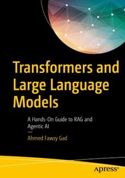
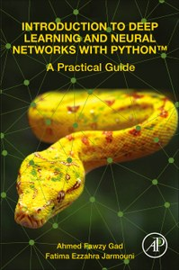
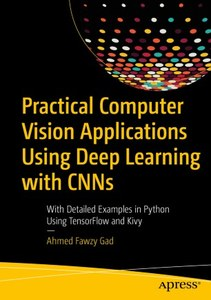
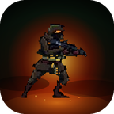
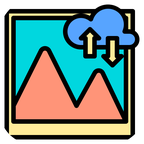

<picture>
  <source media="(prefers-color-scheme: dark)" srcset="assets/header-dark.svg">
  
</picture>

<p align="center">
  <a href="https://www.linkedin.com/in/ahmedfgad"></a>
  <a href="https://x.com/ahmedfgad"></a>
  <a href="mailto:ahmed.f.gad@gmail.com"></a>
  <a href="https://vilvik.com"></a>
  <br>
  <a href="https://scholar.google.com/citations?user=r07tjocAAAAJ&hl=en"></a>
  <a href="https://www.researchgate.net/profile/Ahmed-Gad-12"></a>
</p>

I'm a senior AI engineer and researcher in Ontario, Canada. I've built AI for cybersecurity at Trend Micro and machine learning for cancer research at Medicia Research. I created PyGAD, an open-source genetic algorithm library, and founded Vilvik. I've also written six books and more than 90 tutorials on machine learning, computer vision and Python, and I build mobile apps.

## What I'm Building

<a href="https://vilvik.com">
  <picture>
    <source media="(prefers-color-scheme: dark)" srcset="assets/vilvik-dark.svg">
    
  </picture>
</a>

**[Vilvik](https://vilvik.com)** is my company, an early-stage Canadian startup. Its online application runs evolutionary optimization in the cloud, so you can optimize a decision, tune a model, or evolve a game agent from the browser, the REST API, or Python, without setting anything up. Vilvik also offers AI consulting.

```bash
pip install vilvik
```

[Website](https://vilvik.com) · [Python SDK](https://github.com/VilvikInc/vilvik-python) · [GitHub](https://github.com/VilvikInc) · [LinkedIn](https://www.linkedin.com/company/vilvik) · [X](https://x.com/vilvikinc)

<br>

<a href="https://github.com/ahmedfgad/GeneticAlgorithmPython">
  <picture>
    <source media="(prefers-color-scheme: dark)" srcset="assets/pygad-dark.svg">
    
  </picture>
</a>

**[PyGAD](https://github.com/ahmedfgad/GeneticAlgorithmPython)** is the open-source genetic algorithm library behind it all. It handles single and multi-objective problems and can train Keras and PyTorch models.

[Website (pygad.com)](https://pygad.com) · [Documentation](https://pygad.readthedocs.io) · [GitHub](https://github.com/ahmedfgad/GeneticAlgorithmPython) · [PyPI](https://pypi.org/project/pygad)

<p>
  <a href="https://github.com/ahmedfgad/GeneticAlgorithmPython"></a>
  <a href="https://pypi.org/project/pygad"></a>
  <a href="https://pygad.com"></a>
  <a href="https://pygad.readthedocs.io"></a>
  <a href="https://doi.org/10.1007/s11042-023-17167-y"></a>
</p>

## Selected Projects

| Project | What it does | Stars |
|---|---|---|
| [NumPyCNN](https://github.com/ahmedfgad/NumPyCNN) | Convolutional neural networks built from scratch with NumPy |  |
| [NeuralGenetic](https://github.com/ahmedfgad/NeuralGenetic) | Train neural networks for classification and regression with the genetic algorithm |  |
| [NumPyANN](https://github.com/ahmedfgad/NumPyANN) | Artificial neural networks implemented with NumPy |  |
| [TorchGA](https://github.com/ahmedfgad/TorchGA) · [KerasGA](https://github.com/ahmedfgad/KerasGA) | Train PyTorch and Keras models with PyGAD |  |
| [FederatedLearning](https://github.com/ahmedfgad/FederatedLearning) | A federated learning demo in Python using sockets |  |
| [CoinTex](https://github.com/ahmedfgad/CoinTex) | A cross-platform game written in Python with Kivy, on Google Play |  |
| [ArithmeticEncodingPython](https://github.com/ahmedfgad/ArithmeticEncodingPython) | Data compression with arithmetic encoding in Python |  |
| [GARI](https://github.com/ahmedfgad/GARI) | Reproduce an image with the genetic algorithm by evolving pixel values |  |
| [CIFAR10CNNFlask](https://github.com/ahmedfgad/CIFAR10CNNFlask) | A CNN image classifier served over HTTP with Flask |  |
| [AndroidFlask](https://github.com/ahmedfgad/AndroidFlask) | Upload images from an Android app to a Python Flask server |  |

## Books

<table>
  <tr>
    <td align="center" valign="top" width="25%"><a href="https://www.amazon.com/dp/B0GTPRZ6MY"></a></td>
    <td align="center" valign="top" width="25%"><a href="https://www.amazon.com/dp/0323909337"></a></td>
    <td align="center" valign="top" width="25%"><a href="https://www.amazon.com/dp/1484250303"></a></td>
    <td align="center" valign="top" width="25%"><a href="https://www.amazon.com/dp/1484241665"></a></td>
  </tr>
  <tr>
    <td align="center" valign="top"><b>Transformers and Large Language Models</b><br><sub>A Hands-On Guide to RAG and Agentic AI<br>Apress, 2026</sub><br><a href="https://www.amazon.com/dp/B0GTPRZ6MY">Amazon</a> · <a href="https://link.springer.com/book/10.1007/979-8-8688-2785-3">Springer</a> · <a href="https://github.com/ahmedfgad/Transformers-Gad">Code</a></td>
    <td align="center" valign="top"><b>Introduction to Deep Learning and Neural Networks with Python</b><br><sub>A Practical Guide<br>Academic Press, 2020</sub><br><a href="https://www.amazon.com/dp/0323909337">Amazon</a> · <a href="https://github.com/ahmedfgad/IntroDLPython">Code</a></td>
    <td align="center" valign="top"><b>Building Android Apps in Python Using Kivy with Android Studio</b><br><sub>With Pyjnius, Plyer, and Buildozer<br>Apress, 2019</sub><br><a href="https://www.amazon.com/dp/1484250303">Amazon</a> · <a href="https://github.com/Apress/building-android-apps-in-python-using-kivy">Code</a></td>
    <td align="center" valign="top"><b>Practical Computer Vision Applications Using Deep Learning with CNNs</b><br><sub>With Examples in Python Using TensorFlow and Kivy<br>Apress, 2018</sub><br><a href="https://www.amazon.com/dp/1484241665">Amazon</a> · <a href="https://github.com/Apress/practical-computer-vision-applications">Code</a></td>
  </tr>
</table>

**More books:** [Do Machine Learning Yourself with Python](https://leanpub.com/doml) (Leanpub, 2019) · [TensorFlow: A Guide to Build Artificial Neural Networks Using Python](https://www.amazon.com/dp/6202073128) (LAP Lambert, 2017)

## Research

My work has more than 1,000 citations on [Google Scholar](https://scholar.google.com/citations?user=r07tjocAAAAJ&hl=en). Selected papers:

- [PyGAD: An Intuitive Genetic Algorithm Python Library](https://doi.org/10.1007/s11042-023-17167-y). Multimedia Tools and Applications, 2023. ([arXiv](https://arxiv.org/abs/2106.06158))
- [An Adaptive High-Fidelity Image Compression Framework for Internet of Vehicles](https://doi.org/10.1109/ICC45855.2022.9838913), with Amiya Nayak. IEEE ICC, 2022.
- [Crowd Density Estimation Using Multiple Features Categories and Multiple Regression Models](https://doi.org/10.1109/ICCES.2017.8275346), with Ahmed Hamad and Khalid Amin. IEEE ICCES, 2017.

All my papers are on [Google Scholar](https://scholar.google.com/citations?user=r07tjocAAAAJ&hl=en) and [ResearchGate](https://www.researchgate.net/profile/Ahmed-Gad-12).

## Writing

I've published more than 90 tutorials on machine learning, deep learning and Python, and some have been translated into Chinese, Turkish, Russian and Hungarian.

<p>
  <a href="https://www.kdnuggets.com/author/ahmed-gad"></a>
  <a href="https://medium.com/@ahmedfgad"></a>
  <a href="https://blog.paperspace.com/author/ahmed/"></a>
  <a href="https://www.datacamp.com/profile/ahmedfgad"></a>
</p>

## My Apps

<p>
  <a href="https://play.google.com/store/apps/dev?id=4818949690814466544"></a>
  <a href="https://apps.apple.com/us/developer/ahmed-gad/id6806126560"></a>
</p>

<table>
  <tr>
    <td align="center" valign="top" width="20%"><br><b>Takmila</b><br><sub>Quran memorization by filling in the missing word</sub><br><a href="https://play.google.com/store/apps/details?id=org.takmila.takmila">Google&nbsp;Play</a> · <a href="https://apps.apple.com/us/app/takmila-quran-memorization/id6806126558">App&nbsp;Store</a></td>
    <td align="center" valign="top" width="20%"><br><b>Mawj Quran Radio</b><br><sub>Live Quran radio, recitations and archives</sub><br><a href="https://play.google.com/store/apps/details?id=io.github.ahmedfgad.mawjradio">Google&nbsp;Play</a> · <a href="https://apps.apple.com/us/app/mawj-quran-radio/id6806831995">App&nbsp;Store</a></td>
    <td align="center" valign="top" width="20%"><br><b>SwellFire</b><br><sub>Lead a growing squad through gates to boss battles</sub><br><a href="https://play.google.com/store/apps/details?id=com.vilvik.swellfire">Google&nbsp;Play</a> · <a href="https://apps.apple.com/app/id6821999904">App&nbsp;Store</a></td>
    <td align="center" valign="top" width="20%"><br><b>CoinTex</b><br><sub>60 arcade levels across 6 worlds, built with Python</sub><br><a href="https://play.google.com/store/apps/details?id=coin.tex.cointexreactfast">Google&nbsp;Play</a> · <a href="https://apps.apple.com/app/id6822005164">App&nbsp;Store</a> · <a href="https://github.com/ahmedfgad/CoinTex">Code</a></td>
    <td align="center" valign="top" width="20%"><br><b>EasyUpload</b><br><sub>Send files from Android to a desktop PC</sub><br><a href="https://play.google.com/store/apps/details?id=gad.heartbeat.androidflask.easyupload">Google&nbsp;Play</a></td>
  </tr>
</table>

## Tools I Use

<p>
  
  
  
  
  
  
  
  
</p>
